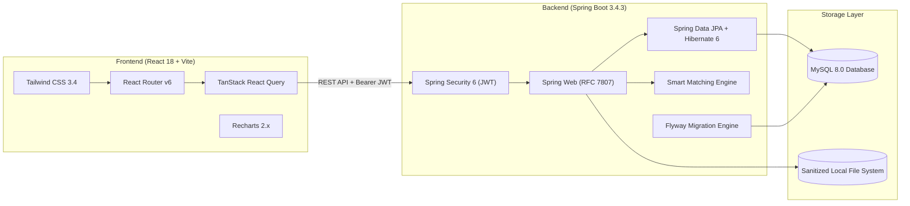

# Smart Lost & Found Recovery Platform

[](https://adoptium.net/)
[](https://spring.io/projects/spring-boot)
[](https://react.dev/)
[](https://www.typescriptlang.org/)
[](https://tailwindcss.com/)
[](LICENSE)

An enterprise-grade, portfolio-ready web application engineered to solve the real-world friction of lost and found recovery. Featuring a **deterministic multi-factor matching engine**, an **ownership verification claim lifecycle**, **role-based administration with audit logging**, and a **modern responsive UI** built with React 18, TypeScript, and Tailwind CSS.

---

## 🌟 Key Highlights

- **Explainable Smart Matching Algorithm**: Deterministic multi-factor scoring combining token-level Jaccard similarity (35%), date proximity (25%), location proximity (25%), and attribute matching (15%) with detailed human-readable justifications.
- **Structured Ownership Claim Lifecycle**: State-machine-driven claim progression (`OPEN` $\rightarrow$ `CLAIM_PENDING` $\rightarrow$ `RESOLVED`), anti-fraud secret questions, and automated rejection of competing claims upon verified approval.
- **Robust Security & RBAC**: Stateless Spring Security 6 with HS256 JWT tokens, BCrypt password hashing, and role-based access control (`ROLE_USER`, `ROLE_ADMIN`).
- **Comprehensive Admin Portal**: Live operational metrics with Recharts analytics, user account management, moderation queues for flagged listings, and immutable system audit logs.
- **Autonomous Zero-Config Testing**: 31 unit & slice integration tests running against an in-memory H2 database in MySQL mode.

---

## 🏗️ Architecture & Technology Stack



| Layer | Technologies |
| :--- | :--- |
| **Backend** | Java 21 LTS, Spring Boot 3.4.3, Spring Security 6, Spring Data JPA, Flyway Migration, JJWT 0.12.6, Springdoc OpenAPI 2.8 |
| **Frontend** | React 18.3, TypeScript 5.6, Vite 6, Tailwind CSS 3.4, TanStack Query v5, React Hook Form, Zod, Recharts 2.15, Lucide React |
| **Database** | MySQL 8.0 (Production / Dev), In-Memory H2 in MySQL Mode (Unit / Integration Tests) |
| **DevOps** | Multi-stage Dockerfiles, Docker Compose, Nginx reverse proxy |

---

## 🚀 Quick Start on Windows 11 (PowerShell)

### Prerequisites
1. **Java 21 LTS** (`java -version` $\ge 21$)
2. **Node.js 18+ & npm** (`node -v`, `npm -v`)
3. **Maven 3.9+** (`mvn -version`)
4. **MySQL 8.0** installed locally or running in Docker

---

### Step 1: Database Setup (MySQL)
Open MySQL Workbench, MySQL Command Line, or run from PowerShell:
```sql
CREATE DATABASE IF NOT EXISTS smart_lost_found CHARACTER SET utf8mb4 COLLATE utf8mb4_unicode_ci;
```

---

### Step 2: Configure MySQL Password
The backend uses `${DB_PASSWORD:your_mysql_password_here}` in `backend/src/main/resources/application.yml`. You can provide your password using **any** of the following methods:

#### Method A: Set Windows Environment Variable (Recommended)
```powershell
$env:DB_PASSWORD="your_actual_mysql_password"
```

#### Method B: Pass via Command-Line Argument
```powershell
mvn spring-boot:run -Dspring-boot.run.arguments="--spring.datasource.password=your_actual_mysql_password"
```

#### Method C: Edit `backend/src/main/resources/application.yml` directly
```yaml
spring:
  datasource:
    password: your_actual_mysql_password
```

---

### Step 3: Run the Backend
From the workspace root:
```powershell
cd "backend"
mvn spring-boot:run
```
> Flyway will automatically run database migrations (`V1__init_schema.sql` and `V2__seed_categories_and_admin.sql`) to generate all tables and default categories.
> The backend server starts at: **`http://localhost:8080`**  
> Interactive Swagger UI: **`http://localhost:8080/swagger-ui/index.html`**

---

### Step 4: Run the Frontend
Open a second PowerShell window:
```powershell
cd "frontend"
npm run dev
```
> The React development server starts at: **`http://localhost:5173`**

---

## 🐳 Alternative: Run with Docker Compose

If you have Docker Desktop running on Windows:
```powershell
docker-compose up --build
```
This automatically boots MySQL 8, the Spring Boot API, and the React client via Nginx:
- **Frontend App**: `http://localhost:3000`
- **Backend API**: `http://localhost:8080`
- **Swagger Documentation**: `http://localhost:8080/swagger-ui/index.html`

---

## 🔑 Demo User Credentials

The application includes pre-configured seed accounts and a 1-click autofill button on the Login page:

| Role | Email | Password | Purpose |
| :--- | :--- | :--- | :--- |
| **System Administrator** | `admin@smartlostfound.com` | `Admin@123456` | Full administrative control, system metrics, user moderation, audit logs |
| **Standard User (Alex)** | `alex.morgan@example.com` | `User@123456` | Report lost items, browse matches, submit ownership claims |
| **Standard User (Sarah)** | `sarah.jenkins@example.com` | `User@123456` | Report found items, review incoming claims, verify proofs |

---

## 🧪 Testing & Verification

### Run Backend Automated Tests (31 Tests)
All tests run against an in-memory H2 database in MySQL mode. No database credentials needed:
```powershell
cd "backend"
mvn test
```
**Results Summary**:
```text
[INFO] Tests run: 31, Failures: 0, Errors: 0, Skipped: 0
[INFO] BUILD SUCCESS
```

### Verify Frontend TypeScript & Production Build
```powershell
cd "frontend"
npm run build
```
Validates zero TypeScript errors and compiles minified bundle to `frontend/dist/`.

---

## 🔍 Core Functional Modules

### 1. Deterministic Multi-Factor Matching Engine
When an item is reported, the matching engine searches for candidate items of the opposite type (`LOST` $\leftrightarrow$ `FOUND`) within the same category:
- **Textual Similarity (35%)**: Word tokenization, stop-word removal, and Jaccard coefficient calculation.
- **Date Proximity (25%)**: Proximity scoring based on calendar day difference ($0$ to $30+$ days).
- **Location Proximity (25%)**: City exact match combined with venue and street address token overlap.
- **Attribute Matching (15%)**: Strict matching on brand names and primary item colors.

Each candidate includes a breakdown with visual progress meters and human-readable explanation tags.

### 2. Claim Verification & State Machine
- When an owner claims a found item, they provide proof description and attempt to answer the reporter's secret question.
- The item moves from `OPEN` to `CLAIM_PENDING`.
- The finder evaluates the claim in their private Claims dashboard.
- Upon approval, the item transitions to `RESOLVED` and all competing claims are automatically closed.

### 3. Admin Oversight & Moderation
- **Analytics**: Real-time KPI summary cards and Recharts trends.
- **Moderation Queue**: Review user-flagged listings with one-click dismiss or remove options.
- **User Management**: Search user accounts and toggle active/banned status.
- **Audit Logs**: Immutable log entries capturing timestamp, user ID, action, entity type, and IP address.

---

## 📂 Project Structure

```text
Smart Lost and Found Recovery System/
├── .env.example                     # Sample environment variable template
├── docker-compose.yml               # Multi-container orchestration
├── docs/
│   ├── architecture.md              # System architecture, DB schema & matching math
│   ├── api.md                       # Complete REST API reference
│   └── testing.md                   # Automated tests & manual QA workflows
├── backend/
│   ├── pom.xml                      # Maven project descriptor
│   ├── Dockerfile                   # Container definition for Spring Boot
│   └── src/
│       ├── main/
│       │   ├── java/com/smartlostfound/
│       │   │   ├── config/          # Security, OpenAPI & web configuration
│       │   │   ├── controller/      # REST API controllers
│       │   │   ├── dto/             # Request & response data transfer objects
│       │   │   ├── entity/          # JPA entity definitions
│       │   │   ├── exception/       # RFC 7807 global exception handling
│       │   │   ├── repository/      # Spring Data JPA repositories
│       │   │   ├── security/        # JWT filter, provider & user details
│       │   │   ├── service/         # Business logic & matching engine
│       │   │   └── util/            # Text similarity utilities
│       │   └── resources/
│       │       ├── application.yml  # Main configuration with MySQL placeholders
│       │       ├── application-test.yml # In-memory H2 test configuration
│       │       └── db/migration/    # Flyway schema & seed SQL files
│       └── test/                    # 27 unit, slice & security tests
└── frontend/
    ├── package.json                 # Node dependencies
    ├── vite.config.ts               # Vite configuration with API proxy
    ├── tailwind.config.js           # Custom Tailwind design system
    ├── Dockerfile                   # Multi-stage frontend container
    ├── nginx.conf                   # Nginx reverse proxy configuration
    └── src/
        ├── components/              # Reusable UI components & modals
        ├── context/                 # AuthContext & state providers
        ├── pages/                   # 18 full-featured application pages
        ├── services/                # Axios API clients & interceptors
        └── types/                   # TypeScript interfaces
```

---

## 💼 Technical Interview Portfolio Highlights

When presenting this project in engineering interviews, emphasize:
1. **Explainable AI / Deterministic Algorithm**: Rather than a black-box model, the multi-factor scoring algorithm provides human-readable explanations that can be audited and debugged.
2. **Defensive API Design**: RFC 7807 Problem Details, strict Jakarta validation, file path traversal defense, and MIME type verification.
3. **Concurrency-Safe State Management**: Transactional claim approval with automatic closure of competing claims to prevent duplicate handovers.
4. **Production DevOps Readiness**: Zero-downtime database migrations with Flyway, multi-stage Docker builds, and isolated H2 test profiles for CI/CD pipelines.

---

## 📄 License
This project is open-source and available under the [MIT License](LICENSE).
