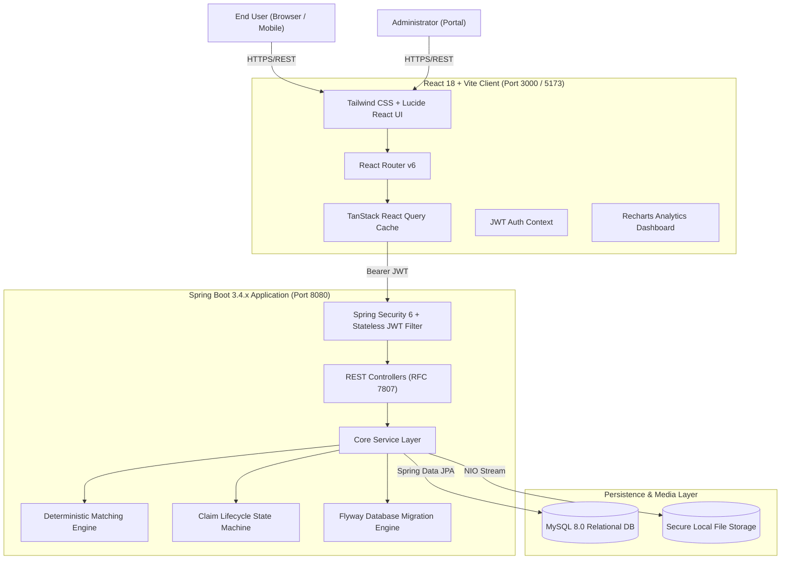
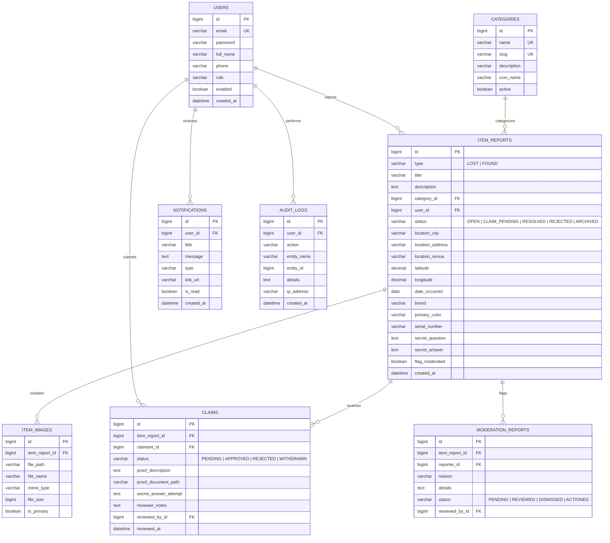
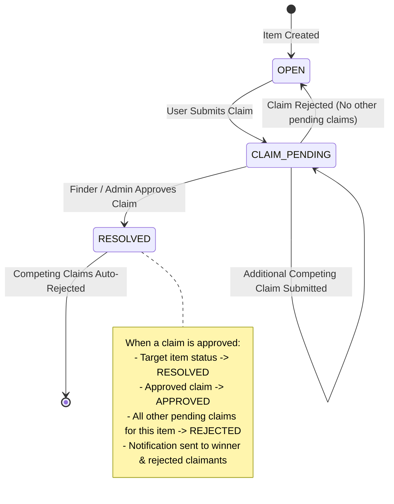

# Smart Lost & Found Recovery Platform - Architecture & Design

## 1. System Overview

The **Smart Lost & Found Recovery Platform** is a full-stack enterprise web application engineered to bridge the gap between lost belongings and honest finders. The system combines an explainable matching algorithm, a structured ownership verification claim lifecycle, and role-based administration with audit logging.

---

## 2. Layered Backend Architecture

The backend follows Clean Architecture and Domain-Driven Design (DDD) principles:

1. **Presentation Layer (`com.smartlostfound.controller`)**:
   - Exposes RESTful endpoints conforming to RFC 7807 problem details.
   - Enforces `@Valid` input constraints via Jakarta Validation.
   - Delegates authorization to Spring Security annotations (`@PreAuthorize`).
   - Standard envelope formatting via `ApiResponse<T>` and `PagedResponse<T>`.

2. **Security & Interception Layer (`com.smartlostfound.security`)**:
   - `JwtAuthenticationFilter`: Extracts and parses `Bearer <token>` from HTTP `Authorization` headers.
   - `JwtTokenProvider`: Issues and cryptographically validates HS256 JWT tokens.
   - `CustomUserDetailsService`: Hydrates `UserPrincipal` with granted authorities (`ROLE_USER`, `ROLE_ADMIN`).
   - `SecurityConfig`: Configures CORS, disabled CSRF for stateless REST, session management, and URL authorization rules.

3. **Service Layer (`com.smartlostfound.service`)**:
   - `MatchingService`: Mathematical multi-factor matching engine with explainability.
   - `ClaimService`: Transactional claim processing, ownership evidence validation, and automatic resolution of competing claims.
   - `ItemReportService`: Search specifications, geospatial/city filtering, and item lifecycle transitions.
   - `FileStorageService`: Strict MIME type checking, extension whitelisting, UUID sanitization, and path traversal defense.
   - `AuditLogService`: Immutable recording of administrative actions.
   - `NotificationService`: In-app event delivery for claims, status updates, and resolutions.
   - `AdminService`: Aggregated metrics and database reporting for operational visibility.

4. **Persistence Layer (`com.smartlostfound.repository`, `entity`)**:
   - 8 Spring Data JPA repositories with `JpaSpecificationExecutor` for dynamic filtering.
   - Hibernate 6 ORM with optimistic locking and indexed foreign keys.
   - Flyway database migration guaranteeing reproducible schema versioning.

---

## 3. Database Schema & Entity Relationships

---

## 4. Deterministic Multi-Factor Matching Algorithm

The `MatchingService` computes a composite compatibility score $S \in [0, 100]$ between a target item $A$ and candidate opposite-type items $B$ ($\text{LOST} \leftrightarrow \text{FOUND}$).

$$S = S_{\text{category}} \times (W_t S_{\text{text}} + W_d S_{\text{date}} + W_l S_{\text{location}} + W_a S_{\text{attributes}})$$

### Factor Breakdown:

1. **Category Compatibility ($S_{\text{category}}$)**:
   - Must match strictly: if $Category(A) \neq Category(B)$, score is penalized or filtered out ($S_{\text{category}} = 0.0$ or severe penalty). Matching categories yield $1.0$.

2. **Textual Similarity ($S_{\text{text}}$, Weight = 35%)**:
   - Normalized Jaccard similarity across title, description, and brand tokens:
     $$J(A, B) = \frac{|Tokens(A) \cap Tokens(B)|}{|Tokens(A) \cup Tokens(B)|}$$
   - Includes stop-word stripping, case folding, and sub-string token inclusion.

3. **Date Proximity ($S_{\text{date}}$, Weight = 25%)**:
   - Measures temporal gap $\Delta t = |Date(A) - Date(B)|$ in days:
     - $\Delta t \le 1$ day: $1.0$ (100%)
     - $\Delta t \le 3$ days: $0.85$ (85%)
     - $\Delta t \le 7$ days: $0.70$ (70%)
     - $\Delta t \le 14$ days: $0.50$ (50%)
     - $\Delta t \le 30$ days: $0.25$ (25%)
     - $\Delta t > 30$ days: $0.05$ (5%)

4. **Location Proximity ($S_{\text{location}}$, Weight = 25%)**:
   - City exact match: $0.60$ baseline.
   - Address/Venue token overlap: Adds up to $0.40$.
   - Same city and venue match: $1.0$ (100%).
   - Different cities: $0.10$ (10%).

5. **Attributes Alignment ($S_{\text{attributes}}$, Weight = 15%)**:
   - Color match: $+50\%$ of attribute weight.
   - Brand match: $+50\%$ of attribute weight.

### Explainability Matrix:
Each match returned by the API includes a structured `MatchExplanationDto` breaking down the individual percentage scores and human-readable justification badges (e.g., *"Same city (San Francisco) and matching electronics brand 'Apple'"*).

---

## 5. Claim Verification State Machine

---

## 6. Frontend Architecture & State Management

- **Modular UI Design**: Built with Tailwind CSS, Lucide React icons, and accessible modal dialogs.
- **Client Cache**: TanStack React Query manages remote server state, query invalidation, caching, and optimistic UI updates.
- **Authentication**: `AuthContext` provides global session state, automatic token persistence in `localStorage`, and reactive logout on 401 response interceptor.
- **Route Guards**:
  - `ProtectedRoute`: Ensures user is authenticated; redirects unauthenticated visitors to `/login?redirect=...`.
  - `AdminRoute`: Verifies `user.role === 'ROLE_ADMIN'`; displays `ForbiddenPage` (403) to non-admin users.
